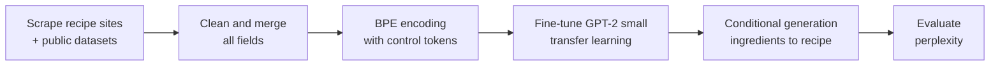

<!-- GitHub profile README for @mhilmisyarif (lives in mhilmisyarif/mhilmisyarif) -->

  

  
  
  
  
  

## 👋 About me

I'm an AI/ML engineer with a Computer Science degree and a soft spot for **language**. My main subject is **Natural Language Processing**: my final research fine-tuned GPT-2 to write Indonesian cooking recipes, and I have been working on text models ever since.

A model is only useful once someone can call it, so I also build the API, the app and the release pipeline around it.

<table>
  <tr>
    <td width="33%" valign="top">
      <h4>🧠 Focus</h4>
      Generative language models and transfer learning for low-resource Indonesian text
    </td>
    <td width="33%" valign="top">
      <h4>📈 Background</h4>
      Data scientist work on sales forecasting and ML models served as REST APIs
    </td>
    <td width="33%" valign="top">
      <h4>🌱 Now learning</h4>
      The Natural Language Processing Specialization, currently on probabilistic models
    </td>
  </tr>
</table>

## 🧠 NLP & Machine Learning

### ⭐ Indonesian recipe generation with GPT-2

My thesis project, and still the one I'm proudest of. Give it a list of ingredients and it writes a complete Indonesian recipe, the way the banner above shows.

<b>How each stage works</b>

 

| Stage | What I did |
|---|---|
| Data | Scraped Indonesian recipe sites and merged them with public datasets into one corpus |
| Preparation | Cleaned every field, then encoded recipes with special tokens that mark where a recipe, its ingredients and its steps begin |
| Training | Fine-tuned GPT-2 small (12 layers, 768 hidden units) first in TensorFlow, later rebuilt on PyTorch and Hugging Face Transformers |
| Inference | Conditional generation from a prompt of ingredients, scored with perplexity |

### More ML work

<table>
  <tr>
    <td width="50%" valign="top">
      <h4>✍️ <a href="https://github.com/mhilmisyarif/handwrittend-digit-app">Handwritten digit generator</a></h4>
      A conditional GAN trained on MNIST that draws any digit you pick, served as a Streamlit app.
        
      <code>TensorFlow</code> <code>Keras</code> <code>Streamlit</code>
    </td>
    <td width="50%" valign="top">
      <h4>📰 News topic classification</h4>
      A bidirectional LSTM that sorts Indonesian news articles into topics.
        
      <code>TensorFlow</code> <code>NLTK</code>
    </td>
  </tr>
  <tr>
    <td width="50%" valign="top">
      <h4>♻️ <a href="https://github.com/mhilmisyarif/trash-classification">Trash classification</a></h4>
      Image classification for waste sorting.
        
      <code>Deep learning</code> <code>Jupyter</code>
    </td>
    <td width="50%" valign="top">
      <h4>📈 Forecasting &amp; regression</h4>
      <a href="https://github.com/mhilmisyarif/price-predict">Car price prediction</a>, <a href="https://github.com/mhilmisyarif/stock-predict">stock forecasting</a>, and product trend forecasts with SARIMAX on Google Trends data.
        
      <code>scikit-learn</code> <code>statsmodels</code> <code>pandas</code>
    </td>
  </tr>
</table>

## 🚀 Apps I've built

<table>
  <tr>
    <td width="50%" valign="top">
      <h4>⚓ <a href="https://github.com/mhilmisyarif/harbor">Harbor</a></h4>
      A dock, menu bar and widget panel for Windows, with signed in-app updates.
        
      <code>Tauri 2</code> <code>Rust</code> <code>React</code> <code>TypeScript</code>
    </td>
    <td width="50%" valign="top">
      <h4>🏪 <a href="https://github.com/mhilmisyarif/warunku">Warunku</a> + <a href="https://github.com/mhilmisyarif/warunku_backend">backend</a></h4>
      Store management for a small warung: products, customers and itemized debt tracking.
        
      <code>Flutter</code> <code>BLoC</code> <code>Express</code> <code>MongoDB</code> <code>Docker</code>
    </td>
  </tr>
  <tr>
    <td width="50%" valign="top">
      <h4>🧪 Lab datasheet system private</h4>
      Role-based workflow for lab test records, review per clause, and generated PDF and Word reports.
        
      <code>React</code> <code>Express</code> <code>Prisma</code> <code>PostgreSQL</code>
    </td>
    <td width="50%" valign="top">
      <h4>🏃 Half-marathon tracker private</h4>
      A 52-week training plan with offline sync and Strava import, as a web app and an Android app.
        
      <code>JavaScript</code> <code>Capacitor</code> <code>Vercel</code> <code>Postgres</code>
    </td>
  </tr>
</table>

## 🛠️ Tech stack

**NLP & machine learning**

  
  
  
  
  
  
  
  
  
  

**Serving & data**

  
  
  
  
  
  
  
  

**Apps**

  
  
  
  
  
  
  

## 📊 GitHub stats

  

## 📫 Let's talk

I'm open to NLP and machine learning roles and collaborations. My full portfolio is at [mhilmisyarif.github.io/portfolio](https://mhilmisyarif.github.io/portfolio/), and the fastest way to reach me is [email](mailto:hilmisyarif.dev@gmail.com) or [LinkedIn](https://www.linkedin.com/in/hilmisyarif/).
